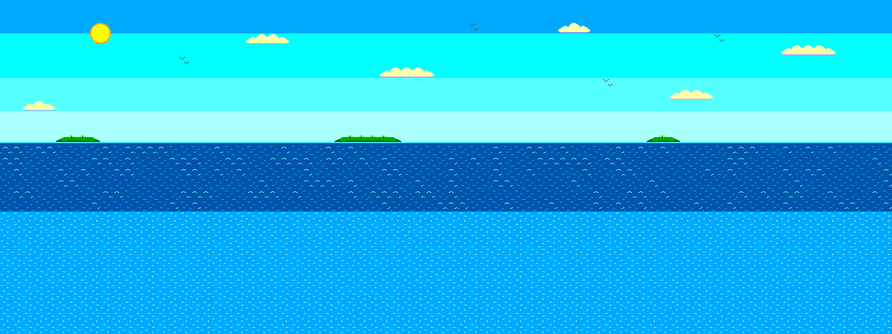
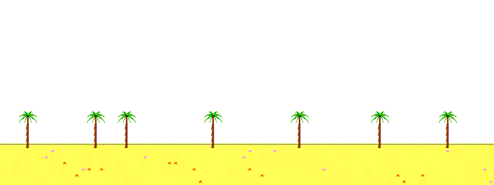
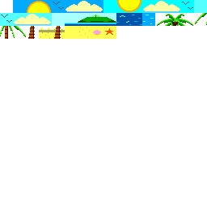

# คู่มือ HW4 – HW6 (Scrolling BG → PPU → Game)

> **กำหนดส่ง:** HW4 = **11 พ.ย. 23:59** · HW5 และ HW6 = 18 พ.ย. 23:59 · **งานเดี่ยวทั้ง 3 งาน**
> ใน myCourseVille ไม่มีโจทย์เขียนไว้ (มีแค่กล่องให้ส่งข้อความ) สเปกจริงอยู่ในสไลด์หน้า 176–206
> HW3 ส่งเป็น 2 ลิงก์ คือ ลิงก์ GitHub + ลิงก์ vga-playground งานนี้ก็ส่งแบบเดียวกันได้ (ดูหัวข้อ 6)

โค้ดอยู่ใน `proj04/`, `proj05/`, `proj06/` ทดสอบแล้วด้วย simulator (รูป `preview*.png` ในแต่ละโฟลเดอร์คือภาพจริงที่โค้ดวาดออกมา)

---

## 0. หัวใจของวิชานี้ในประโยคเดียว

VGA วาดจอ **ทีละ pixel** จากซ้ายไปขวา บนลงล่าง ทุก clock เราได้ `pix_x, pix_y` มา 1 คู่
งานทุกงานจึงเป็นการตอบคำถามเดียวว่า

> **"ตอนนี้ beam อยู่ที่ (pix_x, pix_y) แล้ว pixel นี้ต้องเป็นสีอะไร"**

เราไม่ได้ "วาดรูปลงจอ" แบบโปรแกรมทั่วไป (ไม่มี framebuffer เพราะ memory ไม่พอ)
แต่ **คำนวณสีสดๆ ทีละ pixel** สไลด์เรียกวิธีนี้ว่า *chasing the beam*

ส่วนเกม (ตำแหน่งตัวละคร, แต้ม) อัปเดต **เฟรมละครั้ง** (60 ครั้ง/วินาที) ตอน beam วาดจอเสร็จ:

```verilog
wire new_frame = (pix_x == 0) && (pix_y == 480);   // จริงแค่ 1 clock ต่อเฟรม
always @(posedge clk)
  if (new_frame) begin ...อัปเดตเกม... end
```

---

## 1. ทวนงานที่ทำไปแล้ว แล้วต่อมาถึง tile

| งาน | ไอเดีย | "pixel นี้สีอะไร" |
|---|---|---|
| HW1 Pong | วาดด้วยเงื่อนไข | `if (x อยู่ในกรอบลูกบอล) สีขาว` |
| Image display | เก็บรูปทั้งรูปใน ROM | `img[y*320 + x]` |
| HW2 Text mode | **เก็บตัวอักษร 8x16 + ตารางว่าช่องไหนตัวอะไร** | `font[ text[ช่อง] ][ตำแหน่งในช่อง]` |
| HW3 Transition | ผสมสี 2 รูป | `(1-a)*img1 + a*img2` |
| **HW4 Tile** | **Text mode นั่นแหละ แต่ตัวอักษรเปลี่ยนเป็นรูป 16x16** | `tile[ map[ช่อง] ][ตำแหน่งในช่อง]` |

**ถ้าเข้าใจ Text mode ก็เข้าใจ HW4 แล้ว 80%**

- ascii ROM (font) → **tile ROM** (รูปชิ้นส่วน 256 แบบ) = *Pattern table* ใน NES
- text RAM (ช่องไหนตัวอะไร) → **map ROM** (ช่องไหน tile อะไร) = *Name table* ใน NES

ทำไมต้องทำแบบนี้: รูปเต็มแผนที่ 1280x480 = 614,400 pixel แต่ map 80x30 = 2,400 ช่อง + tile 65,536 pixel ถูกกว่ามาก และ tile ซ้ำๆ (พื้น ฟ้า) ก็ใช้ชิ้นเดียวกันได้

---

## 2. HW4 – Scrolling background (`proj04/`)

### คิดยังไง
1. จอ 640 กว้าง แต่แผนที่ 1280 กว้าง เราเห็นแค่ "หน้าต่าง" กว้าง 640
2. ถ้ากล้องเลื่อนไปทางขวา `scroll_x` pixel ก็แค่ **บวก `scroll_x` เข้ากับ `pix_x`** ก่อนไปเปิดแผนที่
3. ได้ `world_x = pix_x + scroll_x` (ตำแหน่งในแผนที่จริง)
4. แบ่ง 16:
   - `world_x[10:4]` (= world_x / 16) → คอลัมน์ของช่องใน map
   - `world_x[3:0]` (= world_x % 16) → pixel ที่เท่าไรใน tile
   (ตัด bit = หาร/mod ด้วย 2^n ฟรีๆ ไม่ต้องมีวงจรหาร)

```
pix_x ──(+scroll_x)──► world_x ──[10:4]──► MAP ROM ──tile_id──► TILE ROM ──► สี
pix_y ─────────────────────────[8:4]────►    ▲                     ▲
                       world_x[3:0], pix_y[3:0] ───────────────────┘
```

### อ่านโค้ดตามลำดับนี้
1. `png2tiles.py` – แปลงรูป PNG 2 รูปเป็น `beach_tiles.mem` + `beach_map.mem`
2. `map_rom.v` – index = `(layer*30 + row)*80 + col` (2 ชั้นอยู่ในไฟล์เดียว)
3. `tile_rom.v` – index = `{tile_id[7:4], py, tile_id[3:0], px}` (อธิบายในไฟล์ว่าทำไมต่อ bit ได้)
4. `project.v` – 1) scroll 3 ตัว → 2) world_x ของแต่ละชั้น → 3–4) map → tile ทีละชั้น → 5) รวมชั้น

### จากรูป PNG เป็น tile (`png2tiles.py`)
รูปต้นทาง 2 รูป ขนาด 1280x480 (= 80x30 ช่อง ช่องละ 16x16) ใช้สีแค่ 64 สีที่จอแสดงได้:

| | |
|---|---|
| `art/back.png` ชั้นหลัง |  |
| `art/front.png` ชั้นหน้า (ขาว = โปร่งใส) |  |

สคริปต์ทำ 3 อย่าง:
1. **ลดสี** 24-bit → 6-bit: เอา 2 bit บนของ R, G, B (`r >> 6`)
2. **หั่นเป็นช่อง 16x16** แล้วเช็คว่าช่องนี้หน้าตาซ้ำกับที่เคยเจอไหม
   - ซ้ำ → ใช้เลข tile เดิม · ไม่ซ้ำ → เพิ่ม tile ใหม่
3. **เขียนไฟล์**: map = เลข tile ของทุกช่อง, tile sheet = tile ทุกแบบเรียงในรูป 256x256

ผล: 2 รูป = 4,800 ช่อง แต่ใช้ tile แค่ **41 แบบ** เพราะฟ้า ทะเล ทราย ซ้ำกันเยอะ
นี่คือเหตุผลที่ tile ประหยัด memory (ข้อ 1 ด้านบน) 

> ข้อควรรู้ตอนวาดรูป: ของต้องวางตรง grid 16 px ถ้าเมฆก้อนเดียวกันวางเหลื่อม grid จะกลายเป็น tile คนละแบบ และ tile รวมห้ามเกิน 256

### ของที่เพิ่มจากตัวอย่างอาจารย์
**1. Parallax 3 ความเร็ว** ของไกลเลื่อนช้า ของใกล้เลื่อนเร็ว จึงดูมีความลึก

| ส่วน | register | ความเร็ว |
|---|---|---|
| ฟ้า + เมฆ (ไกลสุด) | `scroll_cloud` | 1 px/เฟรม |
| ทะเล | `scroll_sea` | 2 px/เฟรม |
| ชายหาด (ใกล้สุด) | `scroll_beach` | 4 px/เฟรม |

**2. 2 ชั้นซ้อนกัน (BG layer แบบ SNES)** ต้นมะพร้าวต้องยืน*ทับ*ทะเลได้ จึงต้องเปิด map + tile **2 ชุด** ต่อ pixel
```verilog
if (front_color != 3F) color = front_color;   // ชั้นหน้า: มะพร้าว ทราย
else                   color = back_color;    // ขาว = โปร่งใส -> เห็นชั้นหลัง
```
ชั้นหลังยังแบ่งตาม `pix_y` อีกที: `y < 192` (ฟ้า) ใช้ `scroll_cloud` ส่วนที่เหลือ (ทะเล) ใช้ `scroll_sea` (สไลด์ SNES ตั้ง scroll คนละค่าในแต่ละ scanline)

**3. Wrap around แบบไม่กระตุก** ทุกการบวกผ่าน `wrap_add(a, b)` ซึ่งเกิน 1280 ก็ลบ 1280 ออก
- เลื่อนซ้าย 1 = `wrap_add(x, 1279)` (วนรอบ 1280 แล้วถอยมา 1 ช่องพอดี) จึงใช้ฟังก์ชันเดียวได้ทั้งซ้ายและขวา
- แต่ละชั้นมี register ของตัวเองที่วนครบ 1280 เอง

**4. Auto scroll**: `ui_in[2]`

ปุ่ม: `ui_in[0]` ซ้าย · `ui_in[1]` ขวา · `ui_in[2]` เลื่อนอัตโนมัติ

---

## 3. HW5 – PPU (`proj05/`)

### PPU คืออะไร
**การ์ดจอของเครื่องเกมยุค NES/SNES** ซึ่ง CPU ไม่ได้วาดเอง แค่บอก PPU ว่า
"Mario อยู่ x=100 y=352 ท่าที่ 1 หันขวา" แล้ว PPU วาดให้

PPU ใน NES มี 4 ส่วน (สไลด์หน้า 141) ส่วนในโค้ดเราเป็นแบบนี้:

| NES | โค้ดเรา |
|---|---|
| Pattern table (รูป tile/sprite) | `tile_rom.v`, `mario_rom.v`, `coin_rom.v`, `goomba_rom.v` |
| Name table (แผนที่) | `map_rom.v` |
| Palette | ไม่ใช้ (ไฟล์ .mem เก็บสีจริง 6-bit อยู่แล้ว) |
| OAM (ข้อมูล sprite: x, y, ท่า, flip) | reg ใน `project.v` ที่ส่งเข้า port ของ `ppu.v` |

### Sprite วาดยังไง (`sprite_box.v`)
เหมือนลูกบอลใน Pong เลย มีแค่ 2 ขั้น:
1. **อยู่ในกรอบไหม**: `world_x >= pos_x && world_x < pos_x+SIZE && ...` แบบเดียวกัน
2. **ถ้าอยู่ ใช้ pixel ไหนของรูป**: `dx = world_x - pos_x`, `dy = pix_y - pos_y` แล้วไปเปิด ROM

ลูกเล่นที่ได้ฟรี:
- **Flip (หันซ้าย/ขวา)**: `dx = SIZE-1-dx` ทำให้อ่านรูปกลับด้าน
- **Animation**: เปลี่ยน `frame` (เลือกรูปท่าอื่นในไฟล์เดียวกัน) ทุก 8 เฟรม
- **ขยาย 2 เท่า** (Goomba): กรอบ 32 แต่ใช้ `dx/2, dy/2` (`g_dx[4:1]`) อ่านรูป 16x16

### รวมชั้น (Mixer) และสีโปร่งใส
สีขาว `6'h3F` = **โปร่งใส** แล้วเลือกตามลำดับความสำคัญ:
```verilog
color = (mario  != 3F) ? mario  :
        (goomba != 3F) ? goomba :
        (coin   != 3F) ? coin   : background;
```

### กล้องตาม Mario
`scroll_x = mario_x - 304` (ให้ Mario อยู่กลางจอ) แต่ไม่ให้ต่ำกว่า 0 หรือเกิน 640

### ต่างจากตัวอย่างของอาจารย์ยังไง (ควรเข้าใจไว้ เผื่อโดนถาม)
อาจารย์ใช้ **line buffer + topRAM/vRAM** (สไลด์ 193–201) เพราะต้องวาด **64 sprites**
ถ้าเช็คทั้ง 64 ตัวพร้อมกันทุก pixel วงจรจะใหญ่มาก จึงวาดลง buffer ทีละบรรทัดล่วงหน้าแทน

ของเรามีแค่ **5 sprites** จึงเช็คทุกตัว **พร้อมกันแบบขนาน** (sprite_box 5 ชุด) ได้ง่ายๆ
ข้อดีคืออ่านง่าย ข้อเสียคือเพิ่ม sprite แล้วเพิ่มวงจรตามไปเรื่อยๆ (scale ไม่ได้)
ถ้าอยากได้คะแนนเพิ่ม ให้ลองทำตามแบบ line buffer ของอาจารย์ใน `teach_hw/src/sprite_renderer.v`

> **หมายเหตุเรื่อง ROM:** โค้ดนี้อ่าน ROM แบบ `assign` (ได้ค่าทันที) เพื่อให้อ่านง่าย
> ซึ่งใช้ได้ใน vga-playground แต่บน FPGA จริง BRAM ช้าไป 1 clock ต้อง delay ตำแหน่ง (สไลด์หน้า 183)
> แบบที่อาจารย์ทำใน `bg_renderer.v` (`pix_x1_reg`)

ปุ่ม: `ui_in[0]` ซ้าย · `ui_in[1]` ขวา

---

## 4. HW6 – Game using PPU (`proj06/`) "Coin Run"

**ไม่แก้ PPU เลย** (ไฟล์เหมือน HW5 ทุกตัว) เปลี่ยนแค่ `project.v` ซึ่งเป็น "กติกาเกม"
ตรงกับสไลด์หน้า 204 ที่บอกว่า game logic ทำเป็น state machine แทน CPU

### กติกา
- เก็บเหรียญครบ 3 เหรียญ = **ชนะ** (ขอบจอเขียว)
- เหรียญลอยอยู่ ต้องกระโดดเก็บ
- ชน Goomba ด้านข้าง = **แพ้** (ขอบจอแดง)
- กระโดดเหยียบ Goomba = Goomba หาย +1 แต้ม
- แต้ม = สี่เหลี่ยมเหลืองมุมซ้ายบน · กด reset เพื่อเริ่มใหม่

ปุ่ม: `ui_in[0]` ซ้าย · `ui_in[1]` ขวา · `ui_in[2]` กระโดด

### Game loop (ทำทุกเฟรม ในบล็อก `if (new_frame)`)
```
1) เดินซ้าย/ขวา
2) กระโดด : ลอยขึ้น 16 เฟรม (เฟรมละ 5px) → ตกลงเฟรมละ 5px จนถึงพื้น
3) Goomba เดินไปกลับ
4) เช็คชนเหรียญ   → ซ่อนเหรียญ, score+1
5) เช็คชน Goomba  → ตกลงมาทับ = เหยียบ / อย่างอื่น = แพ้
6) เหรียญหมด      → ชนะ
```

### เช็คชน (Collision) = กล่อง 2 กล่องซ้อนกันไหม
```verilog
overlap = (ax < bx + b_size) && (bx < ax + a_size) &&
          (ay < by + b_size) && (by < ay + a_size);
```
แปลว่า A ไม่ได้อยู่ซ้ายสุด/ขวาสุด/บนสุด/ล่างสุดของ B ก็แปลว่าซ้อนกัน

### State machine
```
reset ──► PLAY ──เหรียญครบ──► WIN
            └────ชน Goomba──► LOSE
```

### HUD (แต้ม)
วาด **หลัง** PPU ทับไปอีกชั้น และใช้ `pix_x` ตรงๆ (ไม่บวก scroll) จึงอยู่กับที่บนจอ ไม่เลื่อนตามกล้อง

---

## 5. ไอเดียต่อยอด (ถ้ามีเวลา และอยากให้ไม่ซ้ำเพื่อน)

| งาน | ไอเดีย | ยาก |
|---|---|---|
| HW4 | แก้รูป `art/*.png` เป็นฉากอื่น แล้วรัน `png2tiles.py` ใหม่ | ง่าย |
| HW4 | เลื่อนแนวตั้งด้วย (`scroll_y`) | ง่าย |
| HW5 | Palette swap: เปลี่ยนสี Mario เป็นอีกตัว (สลับ bit สี) | ง่าย |
| HW5 | เพิ่ม sprite แบบ OAM array + line buffer แบบอาจารย์ | ยาก |
| HW6 | ชนกับแผนที่: อ่าน map_rom ที่เท้า Mario ถ้าไม่ใช่ tile 0 = ยืนได้ (ขึ้นท่อได้) | กลาง |
| HW6 | จับเวลา / มีหลายด่าน / Goomba หลายตัว | กลาง |

---

## 6. วิธีรันและส่งงาน

1. push โฟลเดอร์ `proj04`, `proj05`, `proj06` ขึ้น GitHub
2. ลิงก์ playground (รูปแบบเดียวกับที่ส่ง HW3):
   ```
   https://vga-playground.com/?repo=https%3A%2F%2Fgithub.com%2F<user>%2F<repo>&ref=main%2Fproj04
   ```
   (เปลี่ยน `proj04` เป็น `proj05`/`proj06`)
3. ส่งใน myCourseVille: ลิงก์ GitHub ของโฟลเดอร์ + ลิงก์ playground

> ⚠️ repo `MasterIceZ/2110597-100` เป็น repo กลุ่ม แต่ HW4–6 เป็น **งานเดี่ยว**
> เช็คว่าเพื่อนในกลุ่มจะส่งโฟลเดอร์เดียวกันไหม ถ้าส่งให้ใช้ชื่อโฟลเดอร์แยก (เช่น `proj04-<ชื่อ>`) หรือ repo ของตัวเอง

**ปัญหาที่เจอบ่อยใน vga-playground**
- `$readmemh` path ต้องเป็น `"../data/xxx.mem"` และข้อมูลที่โหลดต้องถูกใช้จริง ไม่งั้น error *Invalid typed array length*
- ถ้าเปลี่ยนไฟล์ .mem บนเว็บหลังโหลดไปแล้วจะไม่เปลี่ยน ให้รีเฟรชจากลิงก์ใหม่
- playground อาจใช้เวลาสักพักกว่าจะดึงโค้ดใหม่จาก GitHub
- ห้ามตั้งชื่อสัญญาณว่า `inside`, `as` ฯลฯ เพราะเป็น keyword ของ SystemVerilog

**ทดสอบบนเครื่อง (ไม่บังคับ)** ดู `tools/runf.sh` ซึ่งรัน simulation แล้วได้รูป .png ของจอออกมา
