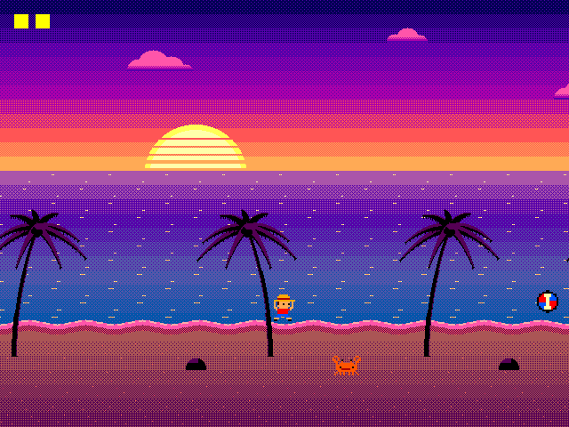

# Graphics Hardware HW4-6

งาน HW4-6 วิชา Graphics Hardware ทำบน Tiny Tapeout VGA Playground ทั้ง 3 งานใช้ฉากเดียวกันคือชายหาดตอนพระอาทิตย์ตก แล้วต่อยอดกันไปเรื่อยๆ

| HW | โฟลเดอร์ | เปิดใน vga-playground |
|---|---|---|
| 4. Scrolling background | [proj04](proj04) | [เปิด](https://vga-playground.com/?repo=https%3A%2F%2Fgithub.com%2FNatdanaiHS%2Fgraphic-hw-4-6&ref=main%2Fproj04) |
| 5. PPU | [proj05](proj05) | [เปิด](https://vga-playground.com/?repo=https%3A%2F%2Fgithub.com%2FNatdanaiHS%2Fgraphic-hw-4-6&ref=main%2Fproj05) |
| 6. Game using PPU | [proj06](proj06) | [เปิด](https://vga-playground.com/?repo=https%3A%2F%2Fgithub.com%2FNatdanaiHS%2Fgraphic-hw-4-6&ref=main%2Fproj06) |



ปุ่มใน playground คือแถบ `ui_in` 0-7 ด้านบนจอ กดหนึ่งครั้งเปิด กดอีกครั้งปิด

- HW4: `0` ซ้าย, `1` ขวา, `2` เลื่อนเอง
- HW5: `0` ซ้าย, `1` ขวา
- HW6: `0` ซ้าย, `1` ขวา, `2` กระโดด (กดปุ่ม reset มุมขวาบนเพื่อเริ่มใหม่)

---

## พื้นฐานที่ทุกงานใช้

VGA จะวาดจอทีละ pixel จากซ้ายไปขวา บนลงล่าง ทุก clock เราได้ `pix_x`, `pix_y` มาหนึ่งคู่ และต้องตอบให้ทันว่า pixel นี้สีอะไร ไม่มี framebuffer เพราะ memory ไม่พอ เลยคำนวณสีสดๆ ทีละ pixel (chasing the beam)

ส่วนที่ต้องขยับ เช่น ตำแหน่งกล้อง ตัวละคร จะอัปเดตแค่เฟรมละครั้ง ตอน `pix_x == 0 && pix_y == 480` (วาดจอเสร็จพอดี) ใช้สัญญาณ `new_frame` ทุกงาน

สีเป็น 6 bit แบบ `RRGGBB` สีละ 4 ระดับ รวมได้ 64 สี และตกลงกันว่าสีขาวล้วน `6'h3F` คือโปร่งใส

---

## HW4 - Scrolling background

### แนวคิด

ถ้าเก็บรูปพื้นหลังทั้งรูปขนาด 1280x480 จะใช้ memory เยอะมาก เลยใช้วิธีเดียวกับ text mode ใน HW2 คือแบ่งรูปเป็นช่อง 16x16 แล้วเก็บแยกเป็น 2 อย่าง

- **tile ROM** เก็บหน้าตาของแต่ละ tile (เหมือน font) เทียบกับ NES คือ pattern table
- **map ROM** เก็บว่าช่องไหนใช้ tile เบอร์อะไร (เหมือน text RAM) เทียบกับ NES คือ name table

ฟ้า ทะเล ทรายซ้ำกันเยอะ ทั้งฉาก 4,800 ช่องเลยใช้ tile จริงแค่ 251 แบบ

แผนที่กว้าง 1280 แต่จอกว้าง 640 การเลื่อนกล้องก็คือบวก offset เข้าไปที่ `pix_x` ก่อนไปเปิดแผนที่ ถ้าแต่ละส่วนบวก offset คนละค่า ของไกลเลื่อนช้า ของใกล้เลื่อนเร็ว ภาพจะดูมีความลึก (parallax)

### ทำยังไง

1. มี scroll register 3 ตัว เพิ่มขึ้นทุกเฟรมตอนกดปุ่ม เมฆ +1 ทะเล +2 ชายหาด +4 pixel
2. ทุก pixel คำนวณ `world_x = pix_x + scroll` ถ้าเกิน 1280 ก็ลบ 1280 ออก แผนที่จะวนต่อกันไม่มีที่สิ้นสุด
3. `world_x[10:4]` กับ `pix_y[8:4]` (คือหาร 16) เป็นตำแหน่งช่อง ส่งเข้า map ROM ได้เลข tile
4. เลข tile กับ `world_x[3:0]`, `pix_y[3:0]` (คือ mod 16) ส่งเข้า tile ROM ได้สี
5. ทำข้อ 2-4 สองชุด ชั้นหน้า (ต้นมะพร้าว ทราย) กับชั้นหลัง (ฟ้า ทะเล) ถ้าสีชั้นหน้าเป็น `3F` ก็ใช้สีชั้นหลังแทน ต้นมะพร้าวเลยยืนทับทะเลได้

ชั้นหลังมีทั้งเมฆและทะเลแต่ใช้ scroll คนละตัว ทำได้โดยเลือกตาม `pix_y` คือถ้า `pix_y < 192` (ส่วนฟ้า) ใช้ scroll ของเมฆ ต่ำกว่านั้นใช้ของทะเล เหมือนที่ SNES เปลี่ยนค่า scroll ระหว่าง scanline

เรื่องการเลื่อนซ้าย ใช้การบวก 1279 แทนการลบ 1 เพราะในรอบ 1280 สองอย่างนี้เท่ากัน เลยใช้ฟังก์ชัน `wrap_add` ตัวเดียวได้ทั้งสองทิศ

### อยู่ตรงไหนในโค้ด

- [`proj04/src/project.v`](proj04/src/project.v): `wrap_add`, `scroll_cloud/sea/beach`, `back_x`, `front_x` และ block สุดท้ายที่เลือกสีระหว่าง 2 ชั้น
- [`proj04/src/map_rom.v`](proj04/src/map_rom.v): แผนที่ 80x60 ช่อง ครึ่งบน (แถว 0-29) เป็นชั้นหลัง ครึ่งล่างเป็นชั้นหน้า address = `(layer*30 + row)*80 + col`
- [`proj04/src/tile_rom.v`](proj04/src/tile_rom.v): tile sheet 256x256 address = `{tile_id[7:4], py, tile_id[3:0], px}` ต่อ bit ได้เลยเพราะทุกขนาดเป็นเลขยกกำลัง 2

### รูปมาจากไหน

วาดเป็น PNG 2 รูปคือ [`art/back.png`](proj04/art/back.png) กับ [`art/front.png`](proj04/art/front.png) (ขาว = โปร่งใส) แล้วรัน

```
cd proj04
python png2tiles.py
```

สคริปต์จะลดสีเหลือ 6 bit หั่นรูปเป็นช่อง 16x16 ช่องไหนหน้าตาซ้ำกับที่เจอแล้วก็ใช้เลข tile เดิม ได้ `data/beach_tiles.mem` กับ `data/beach_map.mem`

ตอนวาดต้องระวัง tile รวมห้ามเกิน 256 ฟ้ากับทะเลเลยไล่สีเป็นแถบสูง 16 px แล้วใช้ dithering (สลับ pixel 2 สีเป็นลาย ตาจะผสมเป็นสีกลางเอง) ลายซ้ำทุก 4 px ช่องในแถวเดียวกันเลยเป็น tile เดียวกันหมด ส่วนต้นมะพร้าวกับหินวางตรง grid 16 px จะได้ใช้ tile ร่วมกัน

---

## HW5 - PPU

### แนวคิด

PPU คือการ์ดจอของเครื่อง NES/SNES ตัวเกม (CPU) ไม่ได้วาดเอง แค่บอก PPU ว่าตัวละครอยู่ไหน ท่าอะไร หันทางไหน แล้ว PPU วาดให้ งานนี้เลยแยกเป็น 2 ส่วน

- `ppu.v` รับข้อมูลแล้วตอบว่า pixel นี้สีอะไร ไม่รู้กติกาเกม
- `project.v` อัปเดตตำแหน่งกับท่าทุกเฟรม ไม่รู้วิธีวาด ทำหน้าที่แทน CPU

ข้อมูลที่ส่งจาก `project.v` เข้า PPU (x, y, frame, flip, show ของแต่ละตัว) ก็คือ OAM ใน NES

### ทำยังไง

PPU = พื้นหลัง 2 ชั้นจาก HW4 + sprite 5 ตัว (คน 1, ปู 1, ลูกบอล 3)

sprite แต่ละตัวทำงานแบบลูกบอลใน Pong

1. หาระยะจากมุมซ้ายบน `off_x = world_x - pos_x`, `off_y = pix_y - pos_y`
2. ถ้า `off_x < 32` และ `off_y < 32` แปลว่าอยู่ในกรอบ ไปเปิด sprite ROM ที่ `{dy, frame, dx}` ได้สีออกมา ถ้าไม่อยู่ก็ตอบ `3F`
3. ถ้า pixel อยู่ซ้ายหรือบนของ sprite ผลลบแบบ unsigned จะวนเป็นเลขใหญ่ เลยไม่ผ่าน `< 32` เอง ไม่ต้องเช็คเพิ่ม

ของที่ได้มาฟรีจากวิธีนี้

- หันซ้าย/ขวา: ใช้ `dx = ~off_x[4:0]` (= 31 - dx) อ่านรูปกลับด้าน ไม่ต้องเก็บรูปหันซ้ายเพิ่ม
- animation: เปลี่ยน `frame` ตามตัวนับเฟรม เช่น `frame_count[3]` สลับทุก 8 เฟรม
- ซ่อน: ส่ง `show = 0`

สุดท้าย mixer ไล่เช็คจากชั้นบนลงล่าง เจอสีที่ไม่ใช่ `3F` ตัวแรกก็ใช้ตัวนั้น ลำดับคือ คน > ปู > ลูกบอล > ชั้นหน้า > ชั้นหลัง

กล้องตามคนด้วย `scroll_x = player_x - 304` (ให้คนอยู่กลางจอ) แต่จำกัดไว้ 0-640 ไม่ให้เลยขอบแผนที่ ทำให้ไม่ต้อง wrap แบบ HW4 parallax เลยใช้แค่ shift ค่าเดียว ชายหาดกับ sprite ใช้ `scroll_x` ทะเลใช้ `scroll_x >> 1` ฟ้าใช้ `scroll_x >> 2`

### อยู่ตรงไหนในโค้ด

- [`proj05/src/sprite.v`](proj05/src/sprite.v): sprite 1 ตัว มี sprite ROM อยู่ข้างใน
- [`proj05/src/ppu.v`](proj05/src/ppu.v): พื้นหลัง 2 ชั้น + sprite 5 ตัว + mixer
- [`proj05/src/project.v`](proj05/src/project.v): เดินซ้ายขวา ปูเดินไปกลับ เลือกท่า คำนวณกล้อง
- `map_rom.v`, `tile_rom.v` ใช้ของ HW4

รูป sprite อยู่ที่ [`art/sprites.png`](proj05/art/sprites.png) ขนาด 256x32 แบ่ง 8 ช่อง ช่องละ 32x32 คือ ยืน, เดิน 1, เดิน 2, กระโดด, ปู 1, ปู 2, บอล 1, บอล 2 แปลงด้วย

```
cd proj05
python png2sprites.py
```

### ต่างจากของอาจารย์ยังไง

ของอาจารย์ใช้ line buffer กับ topRAM/vRAM เพราะต้องวาด 64 sprite ถ้าเช็คทั้ง 64 ตัวพร้อมกันทุก pixel วงจรจะใหญ่เกิน งานนี้มีแค่ 5 ตัวเลยเช็คขนานกันได้เลยไม่ต้องมี buffer อ่านง่ายกว่า แต่ถ้าเพิ่ม sprite วงจรก็โตตามจำนวนตัว

---

## HW6 - Beach Run (game using PPU)

### แนวคิด

ใช้ PPU ของ HW5 แบบไม่แก้เลย (`ppu.v`, `sprite.v`, `map_rom.v`, `tile_rom.v` เหมือนกันทุกไฟล์) เปลี่ยนแค่ `project.v` ให้เป็นกติกาเกม ตรงกับในสไลด์ที่บอกว่า game logic ทำเป็น state machine แทน CPU

กติกา

- เก็บลูกบอลที่ลอยอยู่ครบ 3 ลูก = ชนะ (ขอบจอเขียว)
- ชนปูด้านข้าง = แพ้ (ขอบจอแดง)
- กระโดดเหยียบปู = ปูหาย +1 แต้ม
- แต้มเป็นสี่เหลี่ยมเหลืองมุมซ้ายบน

### ทำยังไง

ทุกเฟรมทำตามลำดับนี้

1. เดินซ้ายขวาตามปุ่ม
2. กระโดด: ลด `player_y` ทีละ 5 เป็นเวลา 16 เฟรม แล้วค่อยตกลงทีละ 5 จนถึงพื้น
3. ปูเดินไปกลับเอง
4. เช็คชนลูกบอล ถ้าชนก็ซ่อนลูกนั้น (`ball_show`) แล้ว +1 แต้ม
5. เช็คชนปู ถ้ากำลังตกลงมา (ลอยอยู่และไม่ได้กำลังขึ้น) ถือว่าเหยียบ ไม่งั้นแพ้
6. ลูกบอลหมดก็ชนะ

การเช็คชนคือดูว่ากล่องสี่เหลี่ยม 2 กล่องซ้อนกันไหม

```verilog
overlap = (ax < bx + b_size) && (bx < ax + a_size) &&
          (ay < by + b_size) && (by < ay + a_size);
```

รูป sprite มีขอบโปร่งใสรอบๆ เลยหดกล่องชนเข้ามาด้านละ 4 px ไม่งั้นจะชนทั้งที่ภาพยังไม่แตะกัน

state machine มีแค่ 3 state

```
reset -> PLAY --เก็บบอลครบ--> WIN
           |
           +----ชนปู-------> LOSE
```

พอเป็น WIN หรือ LOSE ก็หยุดอัปเดตทุกอย่าง รอกด reset

แต้มกับกรอบจอวาดทับหลัง PPU อีกชั้น (HUD) ใช้ `pix_x` ตรงๆ ไม่บวก scroll มันเลยอยู่กับที่บนจอ ไม่เลื่อนตามกล้อง

### อยู่ตรงไหนในโค้ด

- [`proj06/src/project.v`](proj06/src/project.v): ทุกอย่างของเกมอยู่ในไฟล์นี้ ฟังก์ชัน `overlap`, game loop ใน `if (new_frame)`, การเลือกท่า และ HUD ตอนท้าย
- ไฟล์อื่นเหมือน HW5

---

## หมายเหตุ

- ROM อ่านแบบ `assign` ได้ค่าทันที ใช้ใน vga-playground ได้ แต่ถ้าเอาไปลง FPGA จริง BRAM จะช้าไป 1 clock ต้อง delay ตำแหน่งตาม
- ใน playground จะขึ้น warning เรื่องความกว้าง bit บ้าง ไม่มีผลกับการทำงาน
- ทดสอบบนเครื่องได้ด้วย `tools/runf.sh` (ต้องมี iverilog กับ Pillow) เช่น `bash tools/runf.sh proj06 scenario.txt /path/out.png GAME` โดยไฟล์ scenario แต่ละบรรทัดคือ `จำนวนเฟรม ค่าui_in`
