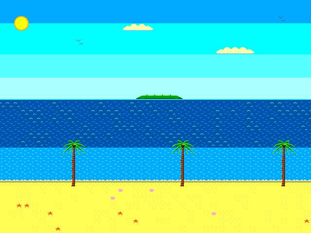
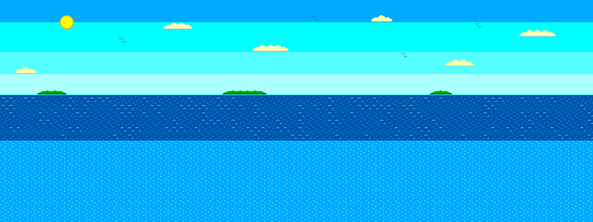
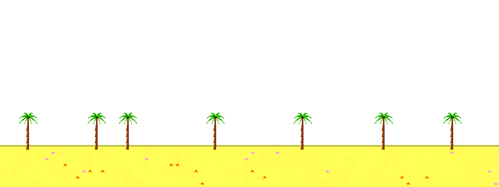
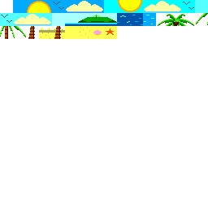

# HW4: Scrolling Background – Beach

Tile-based background (map ROM + tile ROM) made from my own beach picture,
with 2 layers (front: palm trees + sand, back: sky + sea),
3-speed parallax scrolling and seamless wrap-around.

## Controls
- `ui_in[0]`: scroll left
- `ui_in[1]`: scroll right
- `ui_in[2]`: auto scroll

## How the picture becomes tiles
| Source picture (1280x480) | |
|---|---|
| `art/back.png` |  |
| `art/front.png` (white = transparent) |  |

`python png2tiles.py` cuts both pictures into 16x16 cells, keeps each different cell once
(41 tiles), and writes `data/beach_tiles.mem` (tile ROM) + `data/beach_map.mem` (map ROM).

Tile sheet: 

## Files (read in this order)
`png2tiles.py` → `src/map_rom.v` → `src/tile_rom.v` → `src/project.v`.

Explanation in Thai: [../GUIDE_HW4-6.md](../GUIDE_HW4-6.md)
