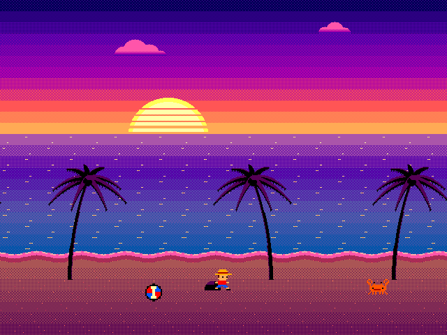

# HW5 - PPU

PPU แบบง่าย พื้นหลัง 2 ชั้นจาก HW4 + sprite 5 ตัว (คน ปู ลูกบอล 3 ลูก) กล้องเลื่อนตามคน

[เปิดใน vga-playground](https://vga-playground.com/?repo=https%3A%2F%2Fgithub.com%2FNatdanaiHS%2Fgraphic-hw-4-6&ref=main%2Fproj05)

ปุ่ม: `ui_in[0]` ซ้าย, `ui_in[1]` ขวา

รูป sprite อยู่ที่ `art/sprites.png` แปลงด้วย `python png2sprites.py` ส่วนพื้นหลังใช้ไฟล์จาก HW4

อธิบายวิธีทำอยู่ใน [README หลัก](../README.md#hw5---ppu)
