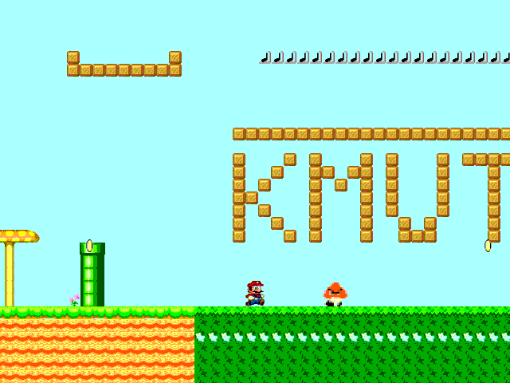

# HW5: Simple PPU

A small Picture Processing Unit: a scrolling background layer plus a sprite layer (Mario, a Goomba drawn at 2x, and 3 coins). It supports flip, animation, a transparency key (`3F`), layer priority, and a camera that follows Mario.

## Controls
- `ui_in[0]`: walk left
- `ui_in[1]`: walk right

## Files (read in this order)
`sprite_box.v` → `*_rom.v` → `ppu.v` → `project.v`. Explanation in Thai: [../GUIDE_HW4-6.md](../GUIDE_HW4-6.md)
