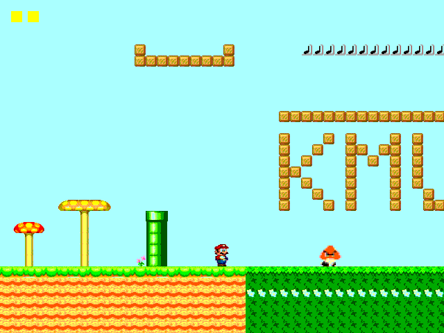
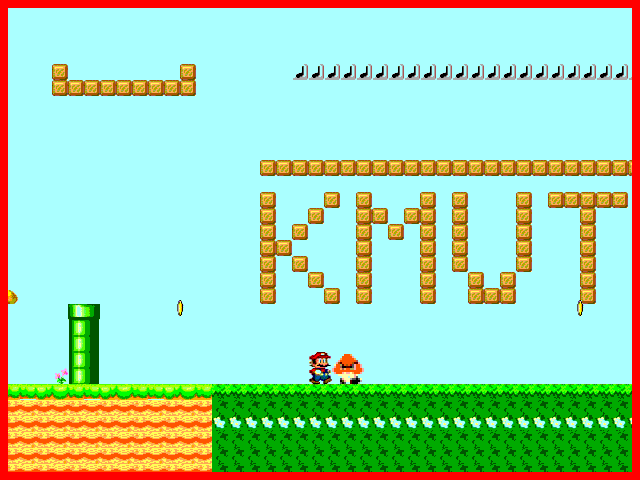
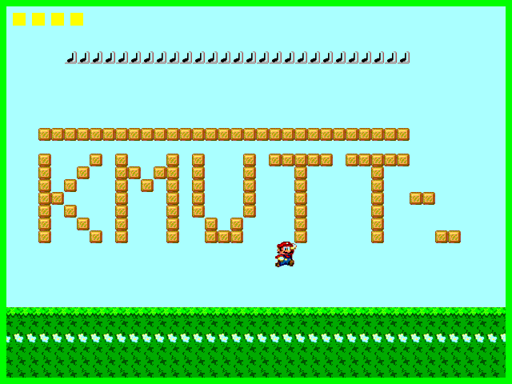

# HW6: Coin Run (Game using PPU)

Uses the HW5 PPU unchanged. Collect all 3 floating coins to win (green border). Touching the Goomba from the side loses (red border); jumping on it removes it and scores a point. The score shows as yellow squares. Press reset to restart.

| Playing | Lose | Win |
|---|---|---|
|  |  |  |

## Controls
- `ui_in[0]`: left
- `ui_in[1]`: right
- `ui_in[2]`: jump

## Files
Same PPU files as HW5. The game logic is only in `project.v`. Explanation in Thai: [../GUIDE_HW4-6.md](../GUIDE_HW4-6.md)
