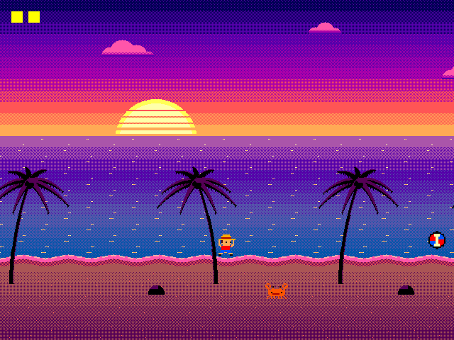
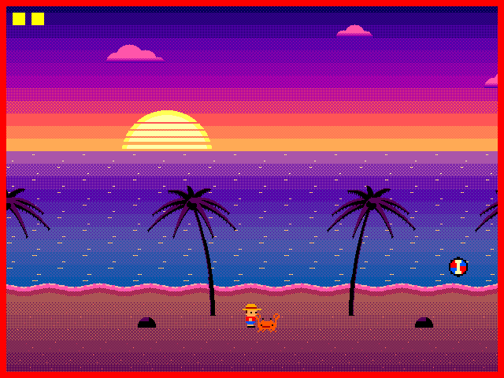
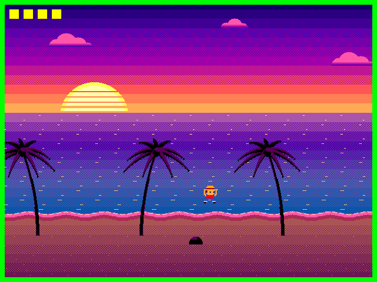

# HW6 - Beach Run

เกมเก็บลูกบอลบนชายหาด ใช้ PPU จาก HW5 โดยไม่แก้ เปลี่ยนแค่ `project.v`

[เปิดใน vga-playground](https://vga-playground.com/?repo=https%3A%2F%2Fgithub.com%2FNatdanaiHS%2Fgraphic-hw-4-6&ref=main%2Fproj06)

| เล่นอยู่ | แพ้ | ชนะ |
|---|---|---|
|  |  |  |

ปุ่ม: `ui_in[0]` ซ้าย, `ui_in[1]` ขวา, `ui_in[2]` กระโดด

เก็บลูกบอลครบ 3 ลูกชนะ ชนปูด้านข้างแพ้ กระโดดเหยียบปูได้แต้ม

อธิบายวิธีทำอยู่ใน [README หลัก](../README.md#hw6---beach-run-game-using-ppu)
